  

  
  
  
  

---

### 🗡️ About me

I build things the way some people go on quests: pick up a weird problem, walk straight into the dangerous forest, and come back with a working system.

These days that forest has two halves. On one side I build **RL environments, graders and reward-hacking defenses** for training and evaluating coding agents. On the other I ship the **production AI platforms, pipelines and cloud infrastructure** real users depend on. Either way I care about one thing: does it hold up under load, on deadline, with real users.

If there's a dragon in the architecture, I usually go looking for it.

- 🧪 **RL Environments Engineer** at Bespoke Labs: agentic coding tasks, delivery-QC gates, a parallel capture farm that took a 50-task batch from ~150 h to ~4 h
- 🏗️ **Director of Technology** at Clarigen AI: founding engineer on three live AI products, scaled to 1000+ concurrent users, 200 ms → 50 ms APIs
- 💼 Open to remote roles

 

---

### 🌍 Open source & research

| Project | What I did |
|---|---|
| **[SREGym](https://github.com/SREGym/SREGym)** *Can AI agents resolve production incidents?* | Merged **[#1130](https://github.com/SREGym/SREGym/pull/1130)** for SREGym 2.0: a regional MySQL failover incident with divergent writes and a recovery backlog, about 4k lines. |
| **[Dense-LSTM Spacecraft Navigation](https://github.com/Skizzy-create/Lightweight-Dense-LSTM-Hybrid-Architecture-for-Real-Time-GPS-Denied-Spacecraft-Position-Estimation)** *Research paper* | A lightweight Dense-LSTM hybrid for real-time, GPS-denied spacecraft position estimation. Paper, reports and notebooks. |

---

### 🛠️ Tech I use

   
   
  

---

### 🏆 Trophies

  

### 📊 Stats

  
  

  

---

<b>🎮 Fun mode: the engineer behind the commits</b> (click to fold)

 

  

  

#### 🚀 The KSP hangar

When I'm not building environments, I'm teaching Kerbal Space Program boats to fight.

| Mod | What it does |
|---|---|
| **[SubTrim](https://github.com/Skizzy-create/SubTrim)** | Submarines that hold depth on their own. On CKAN via [NetKAN](https://github.com/KSP-CKAN/NetKAN). |
| **[skizzy-protocol](https://github.com/Skizzy-create/skizzy-protocol)** | Command naval and air battles from Claude Code, scripts or a tactical map. |
| **[skizzy-naval](https://github.com/Skizzy-create/skizzy-naval)** | Naval combat mod pack, with HullBreach, ASW and Maritime Pack ported to KSP 1.12.5. |

#### 🐍 Snake

<picture>
  <source media="(prefers-color-scheme: dark)" srcset="https://raw.githubusercontent.com/Skizzy-create/Skizzy-create/output/github-snake-dark.svg" />
  <source media="(prefers-color-scheme: light)" srcset="https://raw.githubusercontent.com/Skizzy-create/Skizzy-create/output/github-snake.svg" />
  
</picture>

#### 🕹️ Packet Run

A tiny game lives on my portfolio. [Play it at kartikaslia.vercel.app](https://kartikaslia.vercel.app/#play)

